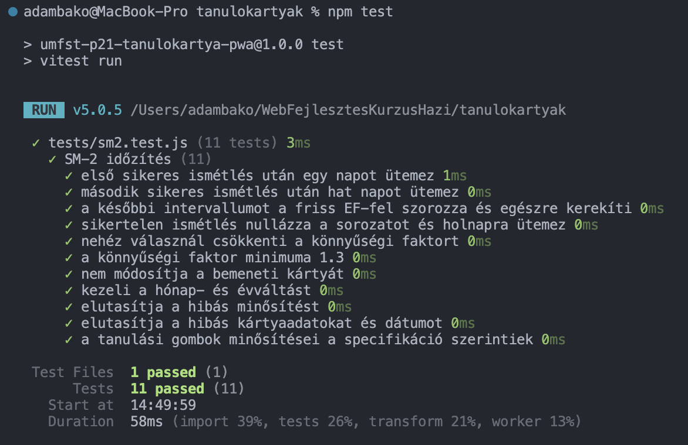
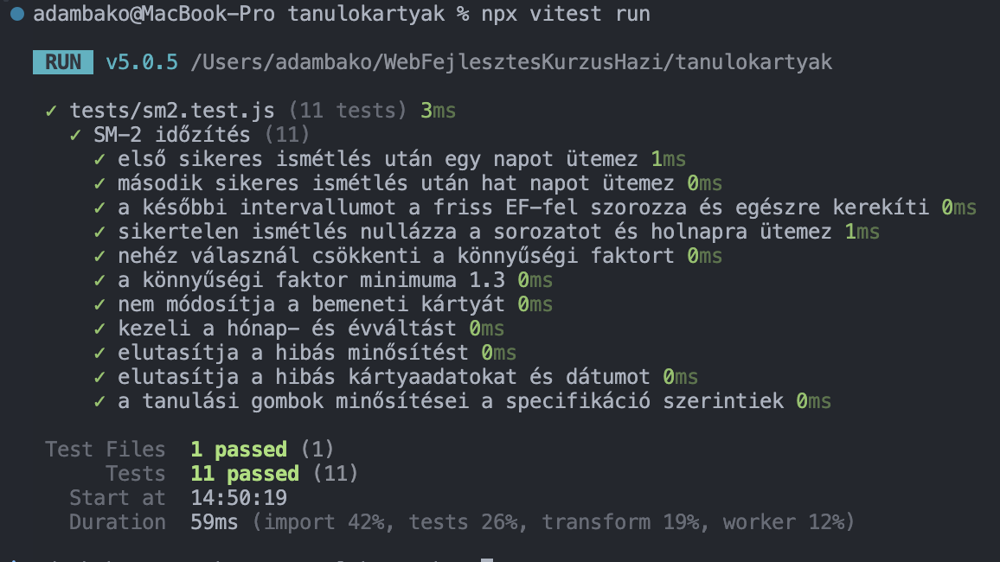
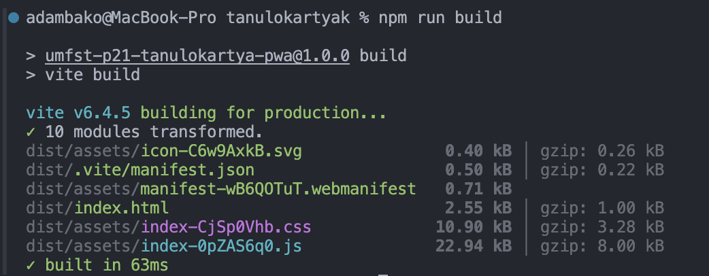
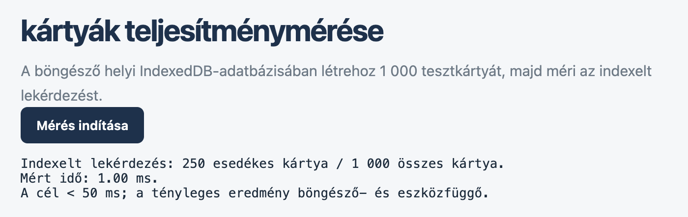

# Vizsgafelkészítő tanulókártyák

**Offline tanulókártyák egyetemi hallgatóknak.**

A Vizsgafelkészítő tanulókártyák egy telepíthető, offline-first PWA, amely SM-2 ismétlési algoritmussal segít a megtanult anyag tartós rögzítésében.

- **GitHub repo:** `umfst-p21-tanulokartya-pwa`
- **GitHub Pages:** [github page](https://bako-adam31.github.io/umfst-p21-tanulokartya-pwa/)
- **Mintapakli:** `samples/tanulokartya.json` 

## Funkciók

- Pakli- és kártyakezelés (létrehozás, olvasás, módosítás, törlés)
- SM-2 alapú ismétlésütemezés
- Billentyűvel vezérelhető tanulási mód
- Napi áttekintés, 30 napos előzmény és előrejelzés
- Verziózott JSON import/export
-  Offline is betölthető mintakártyák
- Offline PWA, Service Workerrel
- GitHub Pages alútvonalas build

## Projektstruktúra

```text
.
├── index.html               # az alkalmazás belépési pontja
├── manifest.webmanifest     # PWA manifest
├── sw.js                    # offline gyorsítótár
├── src/
│   ├── db.js                # IndexedDB réteg
│   ├── sm2.js               # SM-2
│   └── ui/*.js              # UI modulok
├── samples/
    └── tanulokartya.json        # mintapakli

```

## Gyors indítás

Feltétel: Node.js és npm.

```sh
npm install
npm run dev
```

alapértelmezett cim: `http://localhost:5173/`

## Parancsok
| Parancs | Leírás |
|---|---|
| `npm run dev` | Fejlesztői szerver indítása |
| `npm run build` | Production build |
| `npm run preview` | A production build helyi kiszolgálása |
| `npm test` | SM-2 egységtesztek |
| `npx vitest run` | Tesztek egyszeri futtatása |
| `npm run benchmark` | Megnyitja a böngészős teljesítménymérő oldalt |

## SM-2 ismétlési algoritmus

### Az ötlet röviden

Az SM-2 azt feltételezi, hogy minél jobban emlékszel egy kártyára, annál ritkábban kell ismételned. Minden kártya két számot hordoz:
- **EF:** megmondja, milyen gyorsan nőnek az ismétlések közti időközök. Egy új kártya 2,5-ről indul. Ha könnyűnek érzed, az EF nő; ha nehéznek, csökken, de 1.3 alá nem mehet.
- **Intervallum:** hány nap múlva kérdezi a program legközelebb. Emellett a rendszer számolja az egymás utáni sikeres ismétlések számát.

Minden válasz után 0–5 közötti minősítést (q) adsz. Az alkalmazás négy gombot kínál: Újra = 0, Nehéz = 3, Jó = 4, Könnyű = 5.

### Szabályok

1. **Hibás válasz (q < 3):** a sikeres ismétlések száma nullázódik, az intervallum 1 nap lesz, a kártya holnapra kerül. Tehát a kártyát újra „elölről" tanulod.
2. **Sikeres válasz (q ≥ 3):**
   - az 1. sikeres ismétlés után az intervallum **1 nap**,
   - a 2. után **6 nap**,
   - utána az előző intervallum szorozva az **új EF-fel**, egész napra kerekítve.
3. **Az EF frissítése:**

   ```
   EF_új = max(1.3, EF_régi + (0.1 − (5 − q) × (0.08 + (5 − q) × 0.02)))
   ```


## IndexedDB séma

Az adatbázis neve `medkartya-db`

| Object store | Kulcs (`keyPath`) | Indexek | Leírás |
|---|---|---|---|
| `decks` | `id` | – | Paklik. Egy paklihoz több kártya tartozik. |
| `cards` | `id` | `deckId`; `dueDate`; `deckDueDate` = `[deckId, dueDate]` | Kártyák: `front`, `back`, SM-2 állapot (`ef`, `interval`, `repetitions`, `dueDate`, `lastReviewedAt`). A `deckId` a paklira hivatkozik. |
| `reviewLogs` | `id` | `reviewedAt` | Ismétlési napló: kártya, pakli, nap és minősítés. A statisztika és az előzmény ebből készül. |

## Tesztek

```sh
npm test
```


```sh
npx vitest test
```



```sh
npm run build
```



## Teljesítménymérés

```sh
npm run benchmark
```


A benchmark 1 000 tesztkártyát ír, majd `performance.now()` segítségével méri az indexelt esedékes-lekérdezés idejét. Egy helyi mérésben 250 esedékes kártya lekérdezése 1 000 kártyából **1,00 ms** volt.


